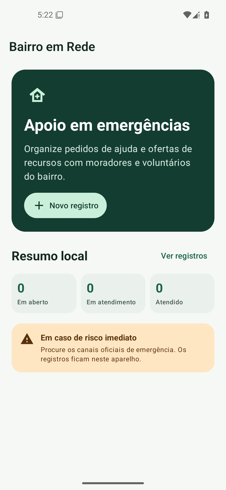
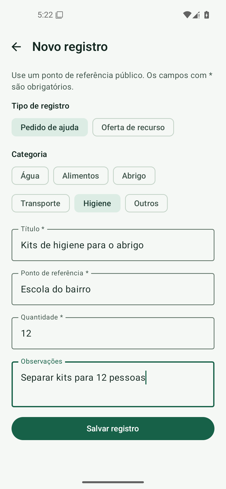
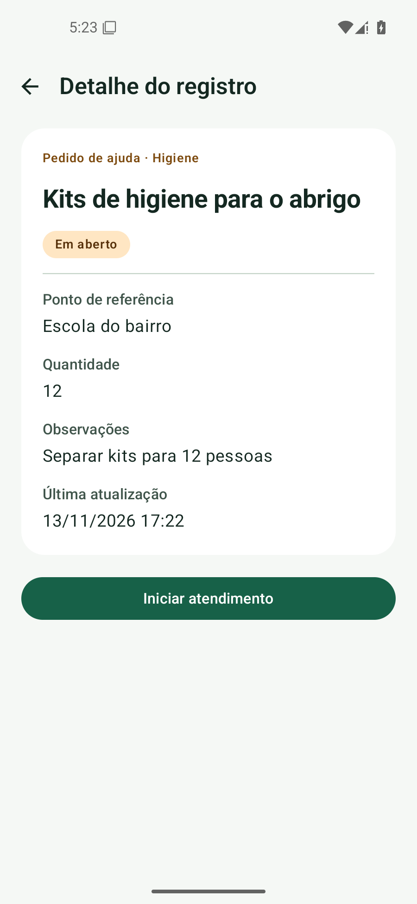
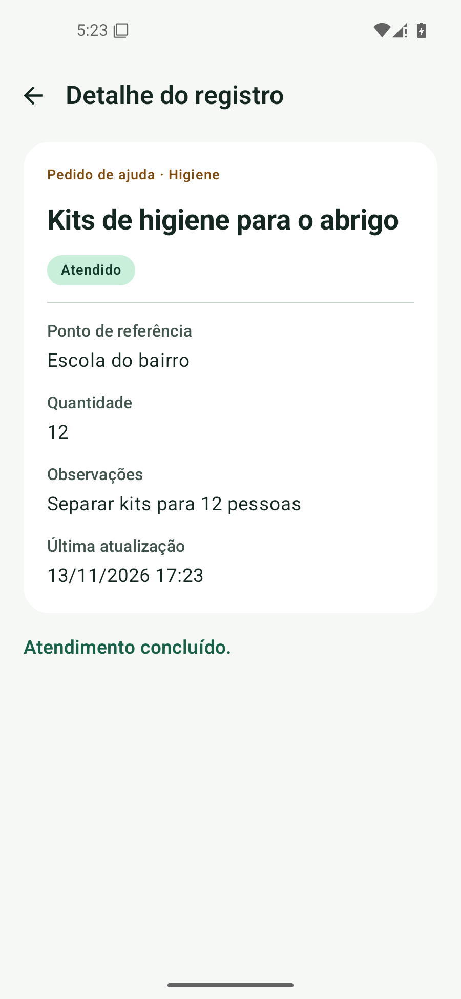
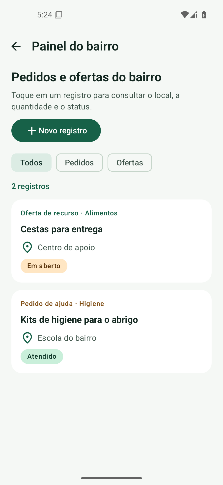

# Bairro em Rede

Global Solution 2026.2 · Android Kotlin Developer · CitizenTech · Tema 14

## Equipe

- Guilhermo Spera Payossin — RM556356
- Luis Carlos — RM554803
- Caroline Rocha — RM556708

## Problema e público

Durante uma enchente ou outro incidente no bairro, pedidos de água, abrigo e transporte podem se espalhar por conversas e anotações. Quem organiza o apoio precisa saber o que ainda falta, onde entregar e quais pedidos já foram atendidos. Uma conexão instável também pode dificultar a consulta dessas informações.

O Bairro em Rede é um protótipo de coordenação comunitária para moradores, voluntários e lideranças de bairro. Uma pessoa responsável pelo painel consegue anotar pedidos e ofertas, consultar os registros e atualizar seu andamento no Android. O armazenamento no aparelho permite usar o painel sem internet. A circulação das informações entre pessoas acontece pelos canais que a comunidade já utiliza.

## Relação com o ODS

O projeto se relaciona com o **ODS 11 — Cidades e comunidades sustentáveis**, em especial com a meta 11.5, que busca reduzir os impactos dos desastres e proteger pessoas em situação de vulnerabilidade. Registrar necessidades e acompanhar o atendimento ajuda a comunidade a identificar quais recursos ainda precisam ser encaminhados. A contribuição do protótipo está na organização da resposta local. [ODS 11 e suas metas, ONU Brasil](https://brasil.un.org/pt-br/sdgs/11)

## Funcionalidades

- A tela **Início** apresenta a proposta e mostra quantos registros estão abertos, em atendimento e atendidos.
- O **Painel** lista os registros e permite filtrar pedidos de ajuda e ofertas de recursos.
- O **Cadastro** registra tipo, categoria, título, ponto de referência, quantidade e observações. Título e local são obrigatórios. A quantidade deve ser um inteiro entre 1 e 999.
- O **Detalhe** exibe os dados, o estado atual e a última atualização. O registro começa em **Em aberto**. O usuário pode avançar para **Em atendimento** e depois para **Atendido**.
- O Room guarda os registros e suas alterações. O painel e o resumo atualizam quando a consulta observável emite novos dados.

## Arquitetura e tecnologias

O projeto usa Kotlin, Jetpack Compose com Material 3, Navigation Compose, ViewModel, corrotinas e Room. A interface coleta o `StateFlow` respeitando o ciclo de vida e envia os eventos ao `RegistrosViewModel`. O ViewModel coordena as operações do `RegistroRepository`. O repositório acessa o `RegistroDao` do Room, que executa as consultas no SQLite. As transições de status conferem o estado anterior na própria atualização do banco.

- `ui` contém as telas, as rotas e os componentes.
- `apresentacao` mantém o estado das telas e valida os dados do formulário.
- `data` concentra a entidade, o DAO, o banco e o repositório.

O app registra pontos de referência públicos. O protótipo opera no próprio dispositivo e orienta o usuário a procurar os canais oficiais em caso de risco imediato.

## Como executar

1. Extraia o ZIP e abra a pasta **BairroEmRede** no Android Studio usando **File > Open**.
2. Use o Android Studio **Panda 2 (2025.3.2)** ou uma versão compatível com o Android Gradle Plugin 9.1. Configure um Gradle JDK 17 ou superior, como o JDK do próprio Android Studio. Instale o **Android SDK Platform 36** e o **Build-Tools 36.0.0** pelo SDK Manager.
3. Aguarde o **Gradle Sync**. A primeira sincronização baixa as dependências. O Gradle Wrapper acompanha o projeto.
4. Selecione a configuração **app** e um emulador ou dispositivo com **Android 7.0 (API 24)** ou superior. Clique em **Run**.

Pelo terminal, o build e os testes locais também podem ser executados com `./gradlew :app:assembleDebug :app:testDebugUnitTest`. No Windows, use `.\gradlew.bat :app:assembleDebug :app:testDebugUnitTest`.

## Demonstração

1. Na tela inicial, abra **Ver registros** para consultar o painel.
2. Escolha **Novo registro** e tente salvar com o título e o ponto de referência vazios. O formulário exibe os campos a corrigir.
3. Cadastre um **Pedido de ajuda** da categoria **Higiene**. Use **Kits de higiene para o abrigo** como título, **Escola do bairro** como referência e quantidade **12**. O app abre o detalhe em **Em aberto**.
4. Toque em **Iniciar atendimento** e depois em **Marcar como atendido**. O detalhe mostra **Atendido** e o painel reflete a alteração.
5. Encerre o aplicativo e abra-o novamente. Em **Ver registros**, confirme que **Kits de higiene para o abrigo** continua como **Atendido**.

### Capturas do emulador

As capturas foram feitas no emulador Android 15 (API 35), com um cenário fictício de apoio a um abrigo.

| Início | Formulário preenchido |
| --- | --- |
|  |  |

| Cadastro concluído | Atendimento concluído | Painel após reabertura |
| --- | --- | --- |
|  |  |  |

[Captura da validação dos campos obrigatórios](docs/capturas/06-validacao.png)

## Testes

Os testes unitários verificam campos em branco, limites de texto e quantidade, criação do registro e transições de status. A demonstração no emulador verifica a validação na interface, a navegação entre telas e a persistência dos registros após encerrar o processo.
